# Flight Explorer — implementation plan

Owner tags: **[MAC]** = work Mac (Claude Code, Opus 5.5, writes all code) · **[WIN]** = Windows laptop (Android Studio, Claude Pro, QA) · **[CI]** = GitHub Actions.

Rule of the project: the Mac never opens Xcode, runs `xcodebuild` or runs iOS Gradle tasks. iOS is built, tested and recorded only in CI.

Verified on 2026-11-03 (§3). Decisions taken then:
- XcodeGen manages the iOS project.
- The repo is public during development, so the full iOS suite runs on every relevant push. Visibility is confirmed at submission (§12).
- Search: an exact airport code wins; otherwise code-prefix OR city word-prefix (§5.2, `docs/NOTES.md`).

### Priority tiers

Every step and every QA item carries one:
- **MUST**: a brief requirement, or something a brief requirement can't be built or demonstrated without.
- **SHOULD**: robustness, verification and polish beyond the letter of the brief.
- **COULD**: nice to have.

**MUST gate:** every MUST is built on **both** apps, and every MUST QA item passes on both, before any SHOULD or COULD work starts. Inside a step, do the MUST bullets first. SHOULD/COULD bullets wait for the gate; §13 lists them in the order to do them.

---

## 0. Timeline (Wed Nov 4 – Thu Nov 5, 2026, UTC-5)

Re-estimated for this scope, starting the morning after planning (Tue Nov 3). The main wall-clock cost is iOS CI round trips: about 10 min for a build, 20–30 min for the full UI suite.

| When | Steps | Done when |
|---|---|---|
| Wed 09:00–09:30 | 1b (WIN runs 1a in parallel, ~1 h) | Mac builds the Android starter; XcodeGen installed |
| Wed 09:30–12:00 | 2, 2b | Repo public; iOS starter builds in CI; XcodeGen project and SKIE spike green in CI |
| Wed 12:00–13:00 | 4 | Server MUST modes and tests green |
| Wed 14:00–16:30 | 5 | Shared domain MUST tests green on JVM |
| Wed 16:30–20:00 | 6 | Persistence, network, repository and store tests green on JVM and on the iOS simulator in CI; the iOS app links with SQLDelight |
| Thu 08:30–13:00 | 7 ∥ 8 (MUST bullets, P4) | MUST screens on both apps; iOS UI tests running in CI |
| Thu 13:00–14:30 | 9 (pass 1), 8.4 | Android MUST items checked by hand; iOS screenshots reviewed |
| Thu 14:30–15:30 | Fixes (P5) | **MUST gate met** |
| Thu 15:30–17:30 | 13 | SHOULD items, then COULD items, in §13 order |
| Thu 17:30–19:30 | 10, 11 | README, NOTES, final review, both recordings |
| Thu 19:30–20:30 | 12 | Clean-clone check, visibility confirmed, submitted |

Effort: about 10 h on Wednesday and 12 h on Thursday, with roughly 2 h of slack before Thursday midnight. If the gate isn't met by Thu 15:30, skip §13 entirely and go straight from fixes to §10–12.

**If we slip, cut in this order**, and log each cut under "Known limitations" in `docs/NOTES.md`:
1. All COULD items: dark mode, large text, screen-reader labels, LeakCanary, the Python fallback server.
2. SHOULD polish: skeleton rows (use a plain spinner), haptics and animations, the camera-fit animation, individually removable chips (keep the chip summary and Reset), the −/+ points buttons, "Flight Explorer" display names.
3. SHOULD robustness and verification: the offline fallback map style, StrictMode, the Compose stability config, iOS sliced observation, `--mode=slow`, Linux CI (run the same commands on the Mac), per-step reviewer passes.
4. Last resort, still inside MUST: shrink the iOS UI suite to Launch, Search + Filters, Selection + Saved and Offline relaunch, and record the iOS demo from the normal UI-test run instead of the slow-paced `DemoWalkthrough`.

Never cut any MUST behaviour, the shared tests, README/NOTES, the final reviewer pass, the two recordings or the submission checks.

---

## 1. Setup the machines — MUST

### 1a. [WIN] Windows laptop (~1 h, start immediately; downloads are slow)
1. Install Git for Windows, GitHub CLI (`winget install GitHub.cli`), Android Studio **Quail 3 or newer** and Claude Code.
2. In Android Studio → SDK Manager, install:
   - Android SDK Platform **37.0** (`platforms;android-37.0`).
   - Build-Tools **37.0.0**.
   - The emulator image `system-images;android-37.0;google_apis;x86_64`.

   Then create a Pixel AVD.
3. `git config --global core.autocrlf input` (the repo's `.gitattributes` also enforces this).
4. `gh auth login`.
5. `gh repo clone AbhyudayaSikri/roame-flight-explorer`, open it in Android Studio and run `androidApp` on the emulator. It should show "Hello world!". This is the brief's "both apps build before implementation" check for Android; record the result in `docs/NOTES.md`.

### 1b. [MAC] Work Mac (~20 min) — status as of 2026-11-03
- Ready:
  - `git`.
  - `gh`: authenticated, pushes over SSH.
  - JDK 17 on PATH; Gradle has already provisioned JDK 25 for the daemon.
  - `ANDROID_HOME=/opt/homebrew/share/android-commandlinetools`, so `local.properties` isn't needed.
- To do:
  ```bash
  sdkmanager "platforms;android-37.0" "build-tools;37.0.0" "platform-tools"
  brew install xcodegen            # 2.46.0; prebuilt bottle, never launches Xcode
  ./gradlew :androidApp:assembleDebug   # Mac baseline: the starter builds
  ```
  - Only `platforms;android-36` and build-tools 35/36 are installed today.
  - `platforms;android-37` is not a valid package ID: API 37 ships as 37.0, 37.1 and 37.2, and the starter uses 37.0.
  - `./gradlew projects` passes without the platform because configuration doesn't need it.
- Xcode.app is installed and selected by `xcode-select`. Leave it alone: no Xcode, no `xcodebuild`, no iOS Gradle tasks (the list is in CLAUDE.md). Those tasks call `xcrun` and `xcodebuild -version`.
- The system `python3` is 3.9.6. That only matters for the COULD Python fallback.

---

## 2. [MAC] Repo — MUST

Done on 2026-11-03: `AbhyudayaSikri/roame-flight-explorer` created as private, first commit `ed2d6a7` ("chore: import starter and planning docs").

- [MUST] Make the repo public for development, since macOS CI minutes are free on public repos:
  ```bash
  gh repo edit --visibility public --accept-visibility-change-consequences
  ```
  On a private repo, the $12/$18 included allowance buys only about 190–290 macOS minutes. Visibility is confirmed again in §12.
- [MUST] Keep logging assumptions and checks in `docs/NOTES.md`.
- [SHOULD] Add `fixtures/*.json text eol=lf` to `.gitattributes` so the fixture is byte-identical on every clone. Today it only has `text=auto`.

---

## 2b. [MAC + CI] CI skeleton before implementation — MUST — ~2.5 h

1. [MUST] **`ios.yml` on the unmodified starter.**
   - Environment:
     - `runs-on: macos-26`.
     - `sudo xcode-select -s /Applications/Xcode_26.4.1.app`.
     - `actions/setup-java@v6` with Temurin 25, so the Gradle daemon toolchain needs no download and the Xcode build phase finds `JAVA_HOME`.
     - `gradle/actions/setup-gradle@v6`.
     - `actions/cache@v6` for `~/.konan`, keyed on `kotlin-2.4.21`.
   - Create and boot one simulator, and reuse its UDID everywhere:
     ```bash
     RUNTIME=$(xcrun simctl list runtimes | awk '/iOS 26.4/ {print $NF; exit}')
     UDID=$(xcrun simctl create ci-iphone "iPhone 17" "$RUNTIME")
     xcrun simctl boot "$UDID" && xcrun simctl bootstatus "$UDID" -b
     ```
   - Run `xcodebuild -list -project iosApp/RoameStarter.xcodeproj`, then `xcodebuild build -project iosApp/RoameStarter.xcodeproj -scheme RoameStarter -destination "id=$UDID"`. The starter's scheme file is named `RoameStarter.xcscheme.xml`, which Xcode ignores, so this run also shows whether an auto-created scheme works.
   - Record the run URL in `docs/NOTES.md` as "iOS starter builds as provided".
   - Triggers:
     - Pushes touching `iosApp/**`, `shared/**`, `server/**`, `fixtures/**` or `.github/**`.
     - `workflow_dispatch`.
     - `concurrency: { group: ios-${{ github.ref }}, cancel-in-progress: true }`.
2. [MUST] **Migrate to XcodeGen** (`iosApp/project.yml`).
   - Keep from the starter:
     - Target `RoameStarter` and bundle ID `travel.roame.takehome.ios`.
     - `Info.plist`, deployment target 17.0 and `SWIFT_VERSION` 6.0.
     - The "Build shared Kotlin framework" pre-build script, verbatim.
     - `FRAMEWORK_SEARCH_PATHS` and `ENABLE_USER_SCRIPT_SANDBOXING = NO`.
   - Add:
     - `OTHER_LDFLAGS: -framework Shared -lsqlite3`. The framework is static, and SQLDelight needs the system SQLite; the flag is harmless before SQLDelight lands.
     - `SWIFT_DEFAULT_ACTOR_ISOLATION: MainActor` on the app target.
     - A `RoameStarterUITests` UI-test target, with a single launch test for now.
     - A shared `RoameStarter` scheme that runs those tests with the Main Thread Checker on.
   - Delete `RoameStarter.xcscheme.xml`.
   - In CI: install XcodeGen 2.46.0 from the GitHub release zip (the runner doesn't ship it), run `xcodegen generate --spec iosApp/project.yml`, then `git diff --exit-code -- iosApp`, so the committed project can't drift.
3. [MUST] **SKIE spike.**
   - Add SKIE 0.10.16 to `:shared`.
   - Expose one `StateFlow<String>` and one sealed interface.
   - Consume them in `RoameStarterApp.swift` with `for await` and `onEnum(of:)`.

   A green run proves SKIE + Kotlin 2.4.21 + Xcode 26.4.1 + Swift 6 work before anything depends on them. If it can't be made green in about 30 min, switch to the fallback in §3.1 and note it.
4. [SHOULD] **`ci.yml`** on `ubuntu-24.04`, for every push and PR: `./gradlew :server:test :shared:testAndroidHostTest :androidApp:assembleDebug`, adding each task once it exists. Use the same Java and Gradle setup.

Commits: `ci: build the iOS starter on macos-26`, `build(ios): generate the Xcode project with XcodeGen`, `build(shared): add SKIE and prove the Swift bridge`.

---

## 3. [MAC] Verified toolchain, libraries and commands — MUST — done 2026-11-03

How each item was checked:
- Latest versions: Maven Central and Google Maven `maven-metadata.xml`.
- Target coverage: per-target artifact requests (android/JVM, `iosArm64`, `iosSimulatorArm64`, `iosX64`).
- The Kotlin/stdlib each library was built with: its `.module` metadata.
- Minimum compileSdk and AGP for Android libraries: `aar-metadata.properties` inside each AAR.
- Release notes and changelogs, the KMP compatibility guide, and the GitHub runner image READMEs.
- Task names: `./gradlew :shared:tasks --all` run on the starter.

Prompt P1 below is the request that produced this section.

### 3.1 Libraries

| Purpose | Pick | How verified | Fallback / notes |
|---|---|---|---|
| Toolchain (pinned) | Kotlin 2.4.21 · Gradle 9.7.0 · AGP 9.3.1 · compileSdk 37.0 · Xcode 26.4 (26.4.1 on CI) · Swift 6 | KMP compatibility guide, row "2.4.20–2.4.21": Gradle 7.6.3–9.7.0, AGP 8.5.2–9.3.1, Xcode 26.4. Kotlin 2.4.21 is the latest stable (2.5.0 is at Beta2) | Don't bump. AGP 9.5.0 (latest on Google Maven) and the runner's default Xcode 26.6 are outside the tested row |
| Serialization | kotlinx-serialization-json 1.12.0; plugin `org.jetbrains.kotlin.plugin.serialization` 2.4.21 | Release notes: "based on Kotlin 2.4.10" | — |
| Dates (internal only) | kotlinx-datetime 0.8.0 | Release notes (May 2026); built on stdlib 2.1.20 | Its JVM implementation uses `java.time`, hence minSdk 26 (§7) |
| Coroutines | kotlinx-coroutines-core 1.11.0 | Release notes: built with Kotlin 2.2.20 | — |
| HTTP client | Ktor 3.6.1: client-core, content-negotiation, serialization-kotlinx-json; okhttp (Android), darwin (iOS) | Release notes (29 Oct 2026); module metadata shows stdlib 2.3.21 | — |
| Server | Ktor 3.6.1 server-core + server-cio, `application` plugin, JVM module `:server` | Same | Netty also works but is heavier. COULD: stdlib `server/fallback.py` (Python 3.9+) |
| DB | SQLDelight 2.4.1: runtime, coroutines-extensions, android-driver, native-driver | Release notes: AGP 9 new-DSL support since 2.3.2; android-driver minSdk 23; Gradle ≥ 8.2.1 | The plugin pulls KGP 2.3.10 at runtime, so declare it in the root `plugins {}` with `apply false`. The static framework needs `-lsqlite3` in Xcode (SQLDelight Gradle docs). Fallback: Room 2.8.5 + sqlite-bundled 2.7.1 + KSP 2.3.13, but sqlite-bundled has no `iosX64` artifact, so `iosX64` would have to go |
| Swift interop | SKIE 0.10.16 (`co.touchlab.skie`) | On Maven Central since 29 Oct 2026. Tag 0.10.16 is commit "Add support for Kotlin 2.4.21 (#211)", which sets `versionSupport.kotlin=…2.4.20(2.4.21)`. Xcode 26 supported since issue #168 | No changelog page yet, hence the spike in §2b. Known issues: #179 (don't force SKIE's own Swift into Swift 6); #208 (if a link fails on macro files, delete `shared/build/skie/**/swift-generated-sources`); #177 (parallel multi-module links; not our case). Fallback: hand-written `observe(onEach): Closeable` plus a Swift `AsyncStream` adapter. KMP-NativeCoroutines 1.0.6 targets Kotlin 2.4.20 and needs KSP plus a Swift package, so it isn't used |
| Android UI | Compose BOM 2026.09.00 (Compose 1.12.1, Material3 1.4.0, material-icons-core 1.7.8), activity-compose 1.13.0, lifecycle-viewmodel-compose + lifecycle-runtime-compose 2.11.0 | Latest stable on Google Maven. Strictest AAR metadata: minCompileSdk 37 and AGP ≥ 9.1.0 (compose-ui, lifecycle) | Skip material-icons-extended (frozen and large) |
| Android map | `org.maplibre.gl:android-sdk-opengl` 13.7.1 + OpenFreeMap `https://tiles.openfreemap.org/styles/liberty` | GitHub release android-v13.7.1 (15 Oct 2026, minSdk 23). Since 13.0.0 the plain `android-sdk` artifact uses Vulkan. The style URL returned 200 | The `-globe` versions are pre-releases, even though Maven's `<release>` tag points at one. Fallback: Google Maps Compose 9.0.1 (needs an API key) |
| iOS map | MapKit: SwiftUI `Map`, `Annotation`, `MapPolyline(coordinates:contourStyle: .geodesic)` | iOS 17 APIs; deployment target 17.0 | — |
| Tests | kotlin-test 2.4.21, kotlinx-coroutines-test 1.11.0, Turbine 1.2.1, ktor-client-mock 3.6.1, ktor-server-test-host 3.6.1, SQLDelight sqlite-driver 2.4.1 (JVM) and native-driver `inMemoryDriver` (iOS) | Maven Central. Turbine 1.2.1 is the latest; it's built on coroutines 1.10.2 and resolves up to 1.11.0 | If Turbine misbehaves, use `first { }` + `withTimeout` |
| Debug (COULD) | LeakCanary 2.14 (`debugImplementation`) | Latest stable (3.0 is still alpha) | — |
| CI | `macos-26`: Xcode 26.4.1 at `/Applications/Xcode_26.4.1.app`, iOS 26.4 runtime with "iPhone 17", JDK 25, android-37.0, build-tools 37.0.0. `ubuntu-24.04`: android-37.0, build-tools 37.0.0, JDK 25. Actions: checkout v7, setup-java v6, gradle/actions/setup-gradle v6, cache v6, upload-artifact v7, download-artifact v8. XcodeGen 2.46.0 | runner-images READMEs (images of 26 Oct 2026); GitHub releases | `macos-15` tops out at Xcode 26.3, so it can't be used |

Targets:
- Every KMP dependency above publishes android/JVM, `iosArm64`, `iosSimulatorArm64` and `iosX64`.
- `iosX64` is Tier 3 in Kotlin 2.4 but not deprecated, so keep it, and set `kotlin.native.ignoreDisabledTargets=true`.
- All Gradle plugin markers resolve from Maven Central or the Plugin Portal.

### 3.2 Commands (mirrored in CLAUDE.md)

`./gradlew :shared:tasks --all` on the starter lists these verification tasks:
- `allTests` and `check`.
- `iosSimulatorArm64Test`, and `iosX64Test`, which is disabled on Apple Silicon (CI runners included).
- `androidConnectedCheck` and `androidDeviceCheck`.

There is no Android host-test task until `kotlin { android { withHostTest {} } }` is added.

| What | Command | Where |
|---|---|---|
| Shared tests on JVM (commonTest + androidHostTest) | `./gradlew :shared:testAndroidHostTest` (one class: `--tests "travel.roame.takehome.SearchTest"`) | Mac, Linux CI, WIN |
| Shared tests on the iOS simulator | `./gradlew :shared:iosSimulatorArm64Test --device "$UDID"` | CI only |
| Server tests / run | `./gradlew :server:test` · `./gradlew :server:run --args="--mode=normal --port=8080"` | Anywhere (Windows: `gradlew.bat`) |
| Server binary for CI | `./gradlew :server:installDist`, then `server/build/install/server/bin/server --mode=…` | CI |
| Android build | `./gradlew :androidApp:assembleDebug` | Mac, Linux CI, WIN |
| Pre-push check | `./gradlew :server:test :shared:testAndroidHostTest :androidApp:assembleDebug` | Mac |
| iOS project | `xcodegen generate --spec iosApp/project.yml` (XcodeGen 2.46.0) | Mac and CI |

Never run on the Mac: `build`, `check`, `allTests`, `assemble`, any `*Ios*` task, or `embedAndSignAppleFrameworkForXcode`.

Where these names come from:
- **`testAndroidHostTest`:**
  - The Android KMP plugin docs name the `androidHostTest` source set and the `hostTest` compilation.
  - androidx's own `run_tests` skill and an AGP 9 migration commit use the task name.
  - Re-check in step 5 with `./gradlew :shared:tasks --all | grep -i hosttest`, and fix CLAUDE.md if the name differs.
  - Don't rely on `allTests` to include it.
- **`iosSimulatorArm64Test`:**
  - Without `--device`, it uses the first available simulator.
  - CI passes the UDID it created, then fails if `shared/build/test-results/iosSimulatorArm64Test/` has no XML. A missing device shows up as a skipped task, not a failure.

---

## 4. [MAC] Local API (`:server`) — MUST — ~1 h

**Spec**
- [MUST] `GET /flights` → 200, with `fixtures/flights.json` as the body byte-for-byte and `Content-Type: application/json`.
- [MUST] `GET /health` → 200 `ok` (CI waits on it).
- [MUST] Flags:
  - `--port=8080` (default).
  - `--fixture=<path>`: default `fixtures/flights.json` under the working directory; the `run` task sets `workingDir = rootDir`.
  - `--mode=`:
    - `normal`.
    - `empty` → 200 `{"flights":[]}` (O5, V5).
    - `error` → 500.
    - `updated` → 200, the fixture with every flight's `points` increased by 500; ids and everything else unchanged (V2).
  - [SHOULD] `--mode=slow` → a 3 s delay, then normal (O6).
- [MUST] `--allow-control`, used only in CI and off by default: `POST /control/mode?value=<mode>` switches the mode at runtime and logs it. This lets one XCUITest go from failure to success (O4's Retry) and set modes without a server restart.
- [MUST] Uses the Ktor CIO engine and binds `0.0.0.0`, so the emulator (`10.0.2.2`) and the simulator (`localhost`) both reach it.
- [MUST] Logs each request: method, path, mode, status.

**One command:** `./gradlew :server:run` (Windows: `gradlew.bat :server:run`), with modes via `--args="--mode=empty"`. CI uses the `installDist` binary instead, so there's no second Gradle invocation next to xcodebuild's build phase.

**Tests [MUST]:** one `testApplication` test per mode:
- `normal`: the body equals the fixture bytes.
- `empty`, and `error` (500).
- `updated`: only `points` changes, by +500.
- `/health`, plus 404 for an unknown path.
- `/control/mode` switches modes only when `--allow-control` is set, and returns 404 otherwise.

**[COULD] Fallback:** `server/fallback.py` (stdlib only, Python 3.9+, same flags). On Windows: `py server\fallback.py`.

**Who runs it:** every machine runs its own copy. The Windows laptop runs it for the emulator, CI starts it in the background before the iOS tests, and a reviewer runs it the same way. The app never bundles a server or the fixture.

Commit: `feat(server): local flights API with failure modes`.

---

## 5. [MAC] Shared domain logic (pure, test-first) — MUST — ~2.5 h

Package `travel.roame.takehome` under `shared/src/commonMain`. Delete `Greeting` once both UIs stop using it.

### 5.0 Build setup [MUST]
- `gradle/libs.versions.toml` holds the §3.1 versions. The root `plugins {}` declares every plugin with `apply false`: kotlin-jvm, serialization, SQLDelight, SKIE.
- Add `kotlin { android { withHostTest {} } }` and confirm `:shared:testAndroidHostTest` exists.
- Add `kotlin.native.ignoreDisabledTargets=true` to `gradle.properties`.
- Fixture for tests:
  - A Gradle task generates `FixtureJson.kt` into a commonTest generated-source directory from `fixtures/flights.json`.
  - The JSON is split into string literals under 16 KB each, because JVM string constants max out at 64 KB.
  - Tests do no file I/O and run the same on JVM and iOS.

### 5.1 Models [MUST]
```kotlin
@Serializable internal data class FlightsEnvelope(val flights: List<FlightDto>)
@Serializable internal data class FlightDto(/* exactly the 13 JSON fields */)

data class CalendarDate(val year: Int, val month: Int, val day: Int) : Comparable<CalendarDate>  // public; LocalDate stays internal
data class GeoPoint(val latitude: Double, val longitude: Double)
data class Flight(
  val id: String, val origin: String, val destination: String,
  val originCity: String, val destinationCity: String,
  val departureDate: CalendarDate, val program: String, val points: Int, val cabin: String,
  val originPoint: GeoPoint, val destinationPoint: GeoPoint,
) {
  val pointsLabel: String = formatPoints(points)          // "16,500 pts"
  val dateLabel: String = formatDate(departureDate)       // "Mon, Feb 1, 2027"
}
data class SavedFlight(val flight: Flight, val savedAtMillis: Long)
```
- **IDs are opaque.** Six fixture ids (`f101`–`f106`) don't follow `fx-ORIG-DEST-YYYYMMDD`, so never parse an id.
- **Cabin and program stay `String`s**, with the known values derived from the data, and they match exactly. "Economy" must not match "Premium Economy" (467 vs 656 flights), and "Mileage Plan" is not "MileagePlus" (203 vs 402).
- **Decoding is strict.** Unknown keys are ignored, but a missing or invalid field makes the whole response `RefreshError.Malformed`, and the cache is kept.

### 5.2 Query, search and filter (pure functions) [MUST]
```kotlin
internal data class FlightQuery(
  val originText: String = "", val destinationText: String = "",
  val dateRange: DateRange? = null,       // null = data bounds
  val cabin: String? = null,              // single-select; null = any
  val maxPoints: Int? = null,             // null = no limit; inclusive
  val programs: Set<String> = emptySet(), // OR within; empty = all
)
data class DateRange(val start: CalendarDate, val end: CalendarDate)   // inclusive on both ends
internal fun filterFlights(flights: List<Flight>, q: FlightQuery, bounds: DataBounds): List<Flight>
```
Search rule, decided 2026-11-03 (examples in `docs/NOTES.md`):
1. Normalize the text: trim, lowercase, and collapse runs of whitespace to a single space. Empty text means no constraint.
2. If the normalized text equals an airport code that appears in the data (32 codes), match only flights whose code in that field equals it: the origin code for the origin field, the destination code for the destination field.
3. Otherwise, match when the airport code starts with the text, or when the city starts with it from any word boundary. That's why "new y" and "san f" work.

On the fixture:
- Destination `dub` → 29 (Dublin only, not Dubai); `du` → 69.
- Origin `fra` → 0: FRA exists only as a destination, and San Francisco isn't matched. `fran` → 123.
- `ork` → 0; `york` and `new y` → 113.

Other rules:
- AND across filter types; OR within programs; an empty filter means all values; the date range and max points are inclusive.
- Sort by departure date, then points, then id, so the order is stable.
- `DataBounds` (public) is derived from the cached data: min/max date, min/max points, cabins, programs, airport codes. It drives the default query and the filter UI.

### 5.3 Map aggregation [MUST]
```kotlin
data class DestinationMarker(val airport: String, val city: String, val point: GeoPoint,
                             val count: Int, val lowestPoints: Int, val label: String /* "55 · 16.5k" */,
                             val hasSaved: Boolean)
internal fun aggregateByDestination(results: List<Flight>, savedIds: Set<String>): List<DestinationMarker>
```
Group by **airport code**, never city: Tokyo is HND + NRT.

### 5.4 Route geometry [MUST]
`internal fun greatCirclePath(from: GeoPoint, to: GeoPoint, segments: Int = 64): List<GeoPoint>`. Longitudes are unwrapped so consecutive points never jump by more than 180°, which matters because 68 of the 192 routes cross the antimeridian.
- Android draws this path.
- iOS uses `MapPolyline(coordinates: [from, to], contourStyle: .geodesic)` instead, because MapKit rejects longitudes beyond ±180.

### 5.5 Formatting (shared, English, so both apps match) [MUST]
- Compact points for markers: 16,500 → "16.5k", 9,000 → "9k", 133,000 → "133k". 491 fixture prices aren't whole thousands, so naive "16k" labels would be wrong.
- Full points ("16,500 pts"), dates ("Mon, Feb 1, 2027") and chip labels.
- `CalendarDate` ↔ UTC-midnight epoch milliseconds, for Android's `DateRangePicker`.

### 5.6 Active filters [MUST]
- `ActiveFilter(kind: FilterKind, label: String)`, where `FilterKind` is ORIGIN, DESTINATION, DATES, CABIN, MAX_POINTS or PROGRAMS.
- The list is empty at defaults.
- A date range equal to the data bounds, or a points limit at the data maximum, counts as "no filter", so it shows no chip.

### 5.7 Tests (`commonTest`). Write these first. [MUST]
Expected numbers come from the real fixture.
- Decoding: the fixture decodes to 1,000 flights; unknown keys are ignored; malformed JSON and a record with an invalid date both give an error.
- Search:
  - Origin `"  jfk "` → 113; `"new york"` → 113.
  - Destination `"TOKYO"` → 110 (HND 55 + NRT 55).
  - JFK + tokyo → 7.
  - Destination `dub` → 29; `du` → 69.
  - Origin `fra` → 0; `fran` → 123; `ork` → 0.
  - No match → empty.
- Dates: Feb 1–Feb 1 → 17; Apr 1–Apr 1 → 21; May 2027 → 0; the full range → 1,000.
- Points: ≤ 9,000 → 1 (`fx-LAX-MEX-20270218`); ≤ 8,500 → 0; ≤ 132,999 → 999; ≤ 133,000 → 1,000; no limit → 1,000.
- Cabin: Economy → 467; Business → 344.
- Programs: Mileage Plan → 203; Avios + Aeroplan → 386; none selected → 1,000.
- Combination: Business + Avios + ≤ 60,000 → 32 (AND across types).
- The `f101`–`f106` records filter and aggregate like any other; the sort order is stable.
- Aggregation:
  - 24 markers at defaults; HND (55, 16,500) and NRT (55, 19,500) are separate.
  - Counts sum to the result count; it respects the filtered input; empty input gives no markers.
- Formatting: the cases in §5.5, plus a `CalendarDate` ↔ UTC-milliseconds round trip.
- Routes: the JFK→HND path never jumps more than 180° and starts and ends at the airports; JFK→LHR stays within ±180.
- `activeFilters`: empty at defaults; one chip per active kind; a full date range or a slider at its maximum gives no chip.

Commit: `feat(shared): flight model, search, filters, aggregation, routes + tests`.

---

## 6. [MAC] Shared data layer and store — MUST — ~3.5 h

### 6.1 Persistence (SQLDelight 2.4.1) [MUST]
```sql
CREATE TABLE cached_flight (id TEXT PRIMARY KEY, …all fields…);
CREATE TABLE saved_flight  (id TEXT PRIMARY KEY, …all fields…, saved_at INTEGER NOT NULL);
CREATE TABLE sync_meta     (key TEXT PRIMARY KEY, value TEXT);  -- last_success_at (epoch ms)
```
- **Successful fetch:** in **one transaction**, replace every `cached_flight` row and set `last_success_at`. An empty success also replaces the cache, because it is the latest successful result.
- **Save:** `INSERT OR REPLACE` into `saved_flight`. That's an upsert, so there are no duplicates and the details get updated. **Remove:** `DELETE … WHERE id = ?`.
- **Refresh** **never** touches `saved_flight`.
- **Threading:** DB calls run on an injected IO dispatcher (`Dispatchers.IO` exists on both JVM and Native). Queries are exposed as `Flow`.
- **Drivers:** `AndroidSqliteDriver` and `NativeSqliteDriver`. Tests use an expect/actual `testDriver()`: `JdbcSqliteDriver(IN_MEMORY)` in androidHostTest, `inMemoryDriver(schema)` in iosTest.
- **iOS linking:** the iOS app links `-lsqlite3` (already in `project.yml`). After this step, the first iOS CI run must do a full `xcodebuild build`. Kotlin/Native test binaries link SQLite by themselves, so a green `iosSimulatorArm64Test` doesn't prove the app links.

### 6.2 Network [MUST]
- `FlightsApi.fetch(): FlightsEnvelope` uses Ktor with a ~10 s timeout: OkHttp on Android, Darwin on iOS. The base URL is injected.
- Error mapping:
  - Connection refused or a timeout → `RefreshError.Offline`.
  - A non-2xx response → `Http(code)`.
  - A decode failure → `Malformed`.

### 6.3 Repository [MUST]
```kotlin
internal interface FlightRepository {          // internal: Result never reaches the ObjC header
  val cachedFlights: Flow<List<Flight>>
  val savedFlights: Flow<List<SavedFlight>>
  val lastSuccessAtMillis: Flow<Long?>
  suspend fun refresh(): Result<Int>           // count fetched
  suspend fun save(f: Flight): Result<Unit>
  suspend fun remove(id: String): Result<Unit>
}
```

### 6.4 SyncState [MUST]
```kotlin
sealed interface SyncState {
  data object Loading : SyncState                                             // first load, no cache
  data class Fresh(val lastSuccessAtMillis: Long) : SyncState
  data class Stale(val lastSuccessAtMillis: Long, val error: RefreshError) : SyncState   // has cache, refresh failed
  data class EmptySuccess(val lastSuccessAtMillis: Long) : SyncState          // 200 with zero flights
  data class FailedNoCache(val error: RefreshError) : SyncState               // show error + Retry
}
sealed interface RefreshError { data object Offline : RefreshError; data class Http(val code: Int) : RefreshError; data object Malformed : RefreshError }
```
On launch, emit the cached data immediately if there is any, then refresh in the background. While refreshing with a cache, keep showing the cache with `isRefreshing = true`.

### 6.5 FlightExplorerStore (single source of truth for both UIs; Swift-friendly) [MUST]
```kotlin
data class ExplorerState(
  val sync: SyncState, val isRefreshing: Boolean,
  val filters: FiltersUi,                  // texts, dateRange, cabin, maxPoints + isPointsLimited, step 500, programs, bounds
  val results: List<Flight>, val resultCount: Int, val totalCount: Int,   // totalCount separates "no matches" from "no data"
  val activeFilters: List<ActiveFilter>,
  val markers: List<DestinationMarker>,
  val focusedDestination: DestinationMarker?, val focusedFlights: List<Flight>,   // marker tapped
  val selected: Flight?, val selectedRoute: List<GeoPoint>, val selectedSaveStatus: SaveStatus,
  val saved: List<SavedFlight>, val savedIds: Set<String>, val selectedSaved: SavedFlight?,
  val message: UserMessage?,               // one-shot text ("Couldn't save flight"), cleared by messageShown()
)
enum class SaveStatus { NOT_SAVED, SAVED, OUTDATED, IN_PROGRESS }
class FlightExplorerStore internal constructor(repo: FlightRepository, scope: CoroutineScope, dispatchers: AppDispatchers) {
  val state: StateFlow<ExplorerState>
  fun setOriginText(text: String); fun setDestinationText(text: String)
  fun setDateRange(start: CalendarDate, end: CalendarDate)
  fun setCabin(cabin: String?)                        // null = any
  fun setMaxPoints(points: Int); fun clearMaxPoints()
  fun toggleProgram(program: String)
  fun clearFilter(kind: FilterKind); fun resetFilters()   // reset also clears both search fields
  fun focusDestination(airportCode: String?)
  fun select(flightId: String?); fun selectSaved(flightId: String?)
  fun save(flightId: String); fun remove(flightId: String)  // save() on a saved flight = "Update saved" (upsert)
  fun refresh(); fun messageShown(); fun close()
  fun setFaultInjection(failSaves: Boolean, failRemoves: Boolean)   // debug builds only
}
```
- **Pipeline:** `combine(cachedFlights, query, savedFlights)` → `mapLatest { withContext(default) { filter + aggregate + derive } }`. The latest query wins.
- **Selection:** store the `selectedId` and derive `selected` from the current results. If the flight drops out of the results, clear the id. Saved-tab selection is separate, so a saved flight opens even when discovery filters exclude it.
- **Focus:** `focusedFlights` is the results for that destination. Clear the focus when its marker disappears.
- **Save status:** `OUTDATED` when the saved snapshot differs from the cached flight with the same id. The card then shows "Update saved" next to Remove.
- **Save/remove:** update `savedIds` and the status optimistically. On failure, roll back and emit `message`; this applies to save and remove alike.
- **Errors never escape `state`.** SKIE turns an exception inside a Flow into a Swift crash. Catch errors in the store, surface them through `sync` or `message`, and keep collecting.
- **Public surface:**
  - The store and the state types above.
  - The value types: `Flight`, `SavedFlight`, `DestinationMarker`, `CalendarDate`, `DateRange`, `DataBounds`, `GeoPoint`, `ActiveFilter`, `FilterKind`, `UserMessage`, `SyncState`, `RefreshError`.
  - `DebugOptions`, `TestIds` and the factories.

  Everything else is `internal`. Public signatures never use `ClosedRange`, `Int?`, `Result`, `Instant` or kotlinx `LocalDate`.
- **Factories:**
  - androidMain: `AndroidExplorer.createStore(context, baseUrl, debug)`.
  - iosMain: `IosExplorer.createStore(baseUrl, debug)`, called from Swift as `IosExplorer.shared.createStore(baseUrl:debug:)`.
- **`DebugOptions(resetData, failSaves, failRemoves)`** wraps the repository in a fault-injecting decorator, used for V6 and the demo. Android toggles the failure flags from a debug menu at runtime via `store.setFaultInjection(failSaves = …, failRemoves = …)`. iOS sets all three at launch from `-resetData`, `-failSaves` and `-failRemoves`.
- **`TestIds`:** an object holding the identifier strings both UIs use (`search.origin`, `card.save`, `marker.HND`, …). XCUITest depends on them.

### 6.6 Tests [MUST] (`commonTest`, using a fake API, Ktor `MockEngine`, an in-memory DB and Turbine)
- Persistence: round trip; upsert gives no duplicates and updated details.
- Saved flights survive a refresh that doesn't include them.
- The cache survives a "restart": a new repository and store on the same driver.
- A failed refresh keeps the cache and gives `Stale`.
- An empty success gives `EmptySuccess`, not a failure.
- No cache plus a failure gives `FailedNoCache`; a retry then succeeds.
- A malformed response is handled.
- Save failure **and** remove failure both roll back and emit a message.
- Selection clears when the flight is filtered out, and persists otherwise.
- Rapid query changes end with the last query's results.
- `focusDestination` lists that marker's flights, and clears when the marker disappears.
- The saved list doesn't change when the query does.
- Offline: with the API failing, search and filters still work on the cache, and remove succeeds.
- `OUTDATED` detection, and "Update saved" upserts one row with the new details.
- Reset clears the search text and all filters, giving 1,000.
- Markers always derive from the same results: after every query change, the marker counts sum to `resultCount`.
- A throwing repository flow becomes a message, and the state keeps updating.
- `close()` cancels collection; nothing is emitted afterwards.

[SHOULD] Before moving on, spawn a fresh reviewer subagent (prompt **P3**). Per-step reviews are SHOULD; the final review in step 10 is MUST.

Commits: `feat(shared): persistence`, `feat(shared): network + repository`, `feat(shared): explorer store + sync state`.

---

## 7. [MAC] Android UI — MUST — ~4.5 h (parallel with step 8, separate git worktree)

MUST:
- **Build config:**
  - `minSdk = 26` in both modules, because kotlinx-datetime's JVM implementation uses `java.time`. The alternative would be core-library desugaring. Log this in NOTES.
  - `INTERNET` permission.
  - A network security config that allows cleartext **only** for `10.0.2.2` and `localhost`.
  - `buildFeatures { buildConfig = true }` and an `API_BASE_URL` field: default `http://10.0.2.2:8080`, overridable with `-PapiBaseUrl=…`.
- **Shell:**
  - `enableEdgeToEdge()` with Scaffold insets; targetSdk 37 enforces edge-to-edge.
  - `ExplorerViewModel` owns the store. `onCleared()` calls `store.close()`. Screens use `collectAsStateWithLifecycle()`.
  - Bottom navigation **Explore | Saved**. Explore has a List/Map segmented toggle sharing one state.
- **Top of Explore:**
  - Origin and destination fields, the result count, active-filter chips and a Reset button.
  - A filter button opens a bottom sheet with:
    - A date range picker, converted through the shared UTC-millisecond helpers.
    - Single-select cabin chips.
    - A max-points slider with a step of 500 that shows the exact value.
    - Program multi-select chips.
- **List:** a `LazyColumn` keyed by `id`.
  - Each row shows the route codes and cities, date, cabin, points and program, plus a saved indicator.
  - Tapping a row selects it.
- **Map:** MapLibre `MapView` (OpenGL artifact) inside `AndroidView`, with lifecycle forwarding to avoid leaks.
  - Markers: one GeoJSON source plus a SymbolLayer of per-marker bitmap icons ("55 · 16.5k"), with `iconAllowOverlap(true)` and `iconIgnorePlacement(true)`. That way HND and NRT are both always visible, and labels don't depend on downloading glyphs.
  - Tapping a marker opens a sheet listing `focusedFlights`.
  - The selected flight draws a LineLayer from `selectedRoute`.
- **Flight card:** origin and destination, date, cabin, points and program, plus Save / Remove / Update saved. Buttons give pressed feedback, show progress, and are disabled while a request is in flight.
- **States:**
  - Loading indicator.
  - "No matching flights" + Reset (resultCount 0, totalCount > 0).
  - "No flights available" (EmptySuccess).
  - Full-screen error with Retry (FailedNoCache).
  - Stale banner ("Offline · showing results from 2:14 PM").
  - Snackbar for `message`; pull to refresh.
- **Saved tab:** snapshots, newest first, with remove and its own detail card. Works offline.
- **Debug menu** (debug builds only): fail saves and fail removes (V6). For fresh-install cases, use the system's "Clear storage".
- **Layout:** consistent spacing and type scale across rows, card, sheets and Saved (QA P1).

SHOULD (after the gate):
- **Camera fit:** frame the selected route, and check a trans-Pacific one. If `LatLngBounds` misbehaves across the antimeridian, centre on the path's midpoint and pick the zoom from the distance.
- **Offline style:** if the remote style can't load, switch to a bundled minimal style so markers and the route still render.
- Each chip removable on its own; −/+ buttons beside the slider; skeleton rows; haptics.
- StrictMode in debug builds: `detectAll().penaltyLog()` for both the thread and VM policies.
- A Compose stability config that marks `travel.roame.takehome.*` models as stable.
- `Modifier.testTag(TestIds.…)` on interactive controls, for parity with iOS and manual QA tooling. There are no Android UI tests.
- App label "Flight Explorer".

COULD: dark theme, a large-font layout pass, TalkBack labels, LeakCanary 2.14.

Commit in slices: navigation shell → list + search → filters → map → card + saved → states.

Then **[WIN] QA pass 1** (§9).

---

## 8. [MAC + CI] iOS UI — MUST — ~4.5 h (parallel with step 7)

### 8.1 CI (extends §2b's `ios.yml`) [MUST]
The repo is public, so the full suite runs on every push to the trigger paths.
1. Setup as in §2b, including the XcodeGen drift check.
2. `./gradlew :shared:iosSimulatorArm64Test --device "$UDID"`. Fail if no test results were written.
3. `./gradlew :server:installDist`, start `server/build/install/server/bin/server --mode=normal --allow-control` in the background, and poll `/health`.
4. `xcodebuild build-for-testing -project iosApp/RoameStarter.xcodeproj -scheme RoameStarter -destination "id=$UDID" -derivedDataPath build/dd`, then `test-without-building` for every test except the API-stopped ones.
   - Mode cases set the mode from inside the test via `POST /control/mode`, and reset it to `normal` in `tearDown`: `empty` (O5, V5), `error` → `normal` (O4's Retry), `updated` (V2).
5. API-stopped cases, on the same simulator: stop the server, then run `-only-testing:RoameStarterUITests/OfflineRelaunchTests`.

   On the first run, confirm the app's data survives between `test-without-building` invocations. If it doesn't, do the relaunch inside one test, using `--mode=error` through the control endpoint as the failing API.
6. Export screenshots with `xcrun xcresulttool export attachments`. Upload the `.xcresult`, the screenshots and the server log using `if: always()`.

```mermaid
flowchart LR
  setupStep["Xcode 26.4.1, JDK 25, XcodeGen 2.46.0"] --> genCheck["xcodegen generate, git diff check"]
  genCheck --> bootSim["Boot iPhone 17, iOS 26.4"]
  bootSim --> kTests["iosSimulatorArm64Test --device UDID"]
  kTests --> srvUp["installDist server with --allow-control, wait for /health"]
  srvUp --> online["XCUITests; modes set via control endpoint"]
  online --> srvDown["Stop server"]
  srvDown --> offline["OfflineRelaunchTests"]
  offline --> upload["Upload xcresult, screenshots, server log"]
```



### 8.2 App [MUST]
- **Info.plist:**
  - `NSAppTransportSecurity → NSAllowsLocalNetworking = YES`.
  - The base URL comes from the key `API_BASE_URL` (default `http://localhost:8080`), overridable with the launch argument `-apiBaseUrl`.
- **Store and model:**
  - `@main` creates the store via `IosExplorer.shared.createStore(baseUrl:debug:)`. In Debug builds, `DebugOptions` comes from the launch arguments.
  - A `@MainActor @Observable final class ExplorerModel` holds the store.
  - A `.task` runs `for await state in store.state { apply(state) }`; it's cancelled with the view, so there's no leak.
  - `@preconcurrency import Shared`; the app target's default isolation is MainActor (from `project.yml`).
- **Navigation:** `TabView` **Explore | Saved**. Explore uses `Picker(.segmented)` for List/Map, sharing one state.
- **Top bar:** two `TextField`s, the count, filter chips in a horizontal `ScrollView`, and Reset.
- **Filter sheet:**
  - Two `DatePicker`s, converted through calendar components into `CalendarDate`.
  - A cabin `Picker`.
  - A points `Slider` with a step of 500.
  - Program toggles.
- **List:** keyed by id.
- **Map:**
  - SwiftUI `Map` with one `Annotation` per marker, labelled by shared `label`.
  - Tapping a marker opens a sheet of `focusedFlights`.
  - The selected flight draws `MapPolyline(coordinates: [from, to], contourStyle: .geodesic)`.
- **Card and states:** mirror Android. Show errors as a banner or alert, and use `.refreshable`.
- **Consistency:** the same spacing and type hierarchy everywhere (QA P1); Save/Remove show progress and can't be double-submitted (QA P2).
- **Identifiers:** `accessibilityIdentifier(TestIds…)` on every interactive control; the UI tests depend on them.

SHOULD (after the gate):
- Camera fits the route via `MKGeodesicPolyline(...).boundingMapRect`.
- The model assigns only the slices that changed (results, markers, selection, saved, sync), so typing doesn't re-render the 1,000-row list.
- `sensoryFeedback` on save; display name "Flight Explorer".

COULD: a dark-mode check, a Dynamic Type pass, VoiceOver labels.

### 8.3 UI tests (XCUITest) [MUST]
- One test class per QA group, with screenshots at key steps (`XCTAttachment`, lifetime `.keepAlways`).
- Fresh-install cases launch with `-resetData`; V6 uses `-failSaves` and `-failRemoves`.

| Class | Covers |
|---|---|
| `LaunchTests` | L1, L2, O7 (rotation via `XCUIDevice.shared.orientation`) |
| `SearchTests` | S1–S5 (S6 after the gate) |
| `FilterTests` | F1–F8, F10 |
| `MapSelectionTests` | M1 (`marker.HND` / `marker.NRT` labels), M3–M7; M8 by screenshot |
| `SavedTests` | V1, V3, V4, V6; V2 (`updated`) and V5 (`empty`) via the control endpoint |
| `ErrorStateTests` | O4 (`error` → error screen; `normal` → Retry loads data), O5 (`empty` on a fresh install) |
| `OfflineRelaunchTests` | O1–O3, with the server actually stopped |

Smoothness items (L3, M2, F9) are judged from the demo recording.
- [MUST] **`DemoWalkthrough`**, plus a manually triggered `demo.yml`.
  - A slow-paced test (1.5–2 s per step): search → filters → map marker → select → save → Saved tab.
  - The workflow then stops the server and runs `DemoOfflineRelaunch`: relaunch, cached data, stale banner, search, remove a saved flight.
  - `xcrun simctl io "$UDID" recordVideo --codec=h264 ios-demo.mp4` runs in the background across both tests, and the mp4 is uploaded.
  - If we slip, record the regular UI-test run instead.

### 8.4 Review loop on the Mac [MUST]
Claude downloads the screenshot artifacts (`gh run download`), looks at each one against the brief and the QA list, fixes layout and spacing problems, and pushes. Results go into `docs/QA_IOS.md`.

---

## 9. [WIN] Android QA passes — MUST

For each QA pass (after step 7, then after fixes):
1. `git pull`.
2. Terminal 1: `gradlew.bat :server:run`. If prompted, allow Java through Windows Firewall (private networks).
3. Run `androidApp` from Android Studio on the emulator.
4. Work through `docs/QA_CHECKLIST.md` with prompt **P6**.
   - Pass 1 covers every MUST item.
   - Pass 2 re-tests the fixes, plus any SHOULD/COULD items that were built.
   - Restart the server with `--mode=empty`, `--mode=error`, `--mode=updated` or `--mode=slow` where the checklist says to.
5. For each failure, run `gh issue create --label qa --label <tier>`, where the tier is `must`, `should` or `could` (create the labels once with `gh label create`). Include steps, expected vs actual, a screenshot and a logcat excerpt.
6. Commit `docs/QA_ANDROID.md` with the results and push. This file is the "checks you actually performed" evidence.

[MAC] picks up the issues with prompt **P5**, MUST issues first.

---

## 10. [MAC] Hardening and docs — MUST — ~2 h

- [MUST] **`README.md`:**
  - Prerequisites.
  - The single server command, including Windows.
  - Android run steps.
  - iOS run steps for a reviewer with a Mac: the `.xcodeproj` is committed, so XcodeGen isn't needed just to build.
  - The test commands (§3.2) and base-URL overrides.
  - Troubleshooting:
    - Emulator networking.
    - `NSAllowsLocalNetworking`.
    - The first-build "No such module 'Shared'".
    - The SKIE #208 cleanup.
- [MUST] **`docs/NOTES.md`:** complete it using the §12 sections.
- [MUST] **Final reviewer pass:** a subagent reviews the whole repo against `docs/BRIEF.md` (prompt **P3**). This is part of how AI output was checked.
- [SHOULD] **Performance pass:**
  - Stable keys and no allocations in hot composables; check recompositions.
  - iOS: don't re-create view models; confirm filtering runs off the main thread.
- [SHOULD] StrictMode log check on WIN (QA T1).
- [COULD] One LeakCanary debug run on WIN (QA T2).

---

## 11. Screen recording — MUST

The brief requires showing both apps: search, filters, map selection, saving flights, and reopening the app with the API stopped.

- **Android [WIN]:** use the emulator's built-in recorder (Extended controls → Record and playback), or OBS for longer takes. Script:
  1. Launch: loading, then 1,000 results.
  2. Origin "new york", destination "tokyo" → 7 flights to HND and NRT.
  3. Filters: dates, cabin Business, max points, two programs. Show the chips, then Reset → 1,000.
  4. Map: pan and zoom, tap the NRT marker, pick a flight, show the route and the card.
  5. Save. Switch to the list to show the selection is kept, then open the Saved tab.
  6. Stop the server (Ctrl+C), force-quit the app and reopen it: cached data, the stale banner, search still works, saved flights are visible, remove one.
  7. Optional: clear app data with the server stopped, to show the error and Retry.
- **iOS [CI]:** run the `demo` workflow, then download `ios-demo.mp4`.
- **Combine:** edit both clips together in Clipchamp (built into Windows), with short title cards: "Android (Compose)" and "iOS (SwiftUI), recorded on CI simulator". Keep it to 5 min or less.

---

## 12. Submission — MUST

- **`docs/NOTES.md` sections** (the assumptions list already lives there):
  1. **Approach and architecture:** the shared store as single source of truth; what lives in shared vs native; library choices and why.
  2. **Assumptions:** every entry dated, with its reason.
  3. **Tradeoffs:**
     - MapLibre vs Google Maps (no key).
     - SQLDelight vs Room.
     - SKIE vs a hand-written bridge.
     - XcodeGen vs a hand-edited project.
     - iOS verified via the CI simulator plus XCUITest rather than interactively.
  4. **Known limitations**, including every item cut under §0.
  5. **Checks actually performed:** link `QA_ANDROID.md`, `QA_IOS.md`, the CI runs and the test list.
  6. **How AI was used and verified:**
     - Planning was verified in Cursor.
     - Claude Code (Opus 5.5) on the Mac implemented the work, with reviewer subagents.
     - Claude Pro on Windows assisted QA triage.
     - Everything was checked through requirement-to-test mapping, CI, manual Android QA and iOS screenshot review.
     - List the concrete things that were rejected or corrected.
- **Final checks:** a clean clone on WIN, `gradlew.bat :server:run`, then the app runs; both workflows are green.
- **Confirm visibility** (the repo was public during development):
  1. If public is fine, leave it and send the link.
  2. If the repo must be private:
     - First run the final iOS workflow and download its artifacts, because private repos meter macOS minutes.
     - Then run `gh repo edit --visibility private --accept-visibility-change-consequences`.
     - Add each reviewer with `gh api -X PUT repos/AbhyudayaSikri/roame-flight-explorer/collaborators/<login> -f permission=pull`.
     - Check with `gh repo view --json visibility`.
  3. Or send a ZIP: `git archive --format=zip -o roame-flight-explorer.zip HEAD`.
- Submit the repo link or the ZIP, plus the video.
- **Before submitting, read every diff yourself** and be ready to change any part live.

---

## 13. SHOULD / COULD backlog (only after the MUST gate, in this order)

1. SHOULD — per-step reviewer pass over the shared code and both UIs (P3), if one hasn't run since the last big change.
2. SHOULD — Android offline fallback map style (QA O8).
3. SHOULD — camera fits the selected route on both apps (QA M9).
4. SHOULD — `ci.yml` Linux workflow.
5. SHOULD — StrictMode in debug builds (QA T1).
6. SHOULD — iOS sliced observation and the Compose stability config.
7. SHOULD — polish: individually removable chips, −/+ points buttons, skeleton rows, haptics, "Flight Explorer" display names.
8. SHOULD — `--mode=slow` (QA O6), the search-rule QA (S6), `.gitattributes` LF for the fixture, Android `testTag`s.
9. COULD — dark mode (P3), large text (P4), screen-reader labels (P5), LeakCanary (T2), the Python fallback server.

---

## Appendix A. Requirement traceability (MUST)

| # | Brief requirement | Step | Shared test | QA |
|---|---|---|---|---|
| R1 | SwiftUI and Compose apps on a shared KMP data layer | 5–8 | — | all |
| R2 | Both starter apps build before implementation | 1a, 1b, 2b | — | NOTES checks |
| R3 | `GET /flights` → 200 + fixture envelope; one documented command | 4, 10 | server tests | A1, A2 |
| R4 | Networking, persistence, search, filtering implemented once in KMP | 5, 6 | all shared tests | final review |
| R5 | Fetch, persist the last successful results, store saved flights | 6.1–6.3 | round trip, restart | O2 |
| R6 | Separate origin/destination search, code or city, ignoring case and surrounding whitespace | 5.2 | search tests | S1–S4 |
| R7 | Departure date range including both boundary dates | 5.2 | date tests | F1, F2 |
| R8 | Cabin filter | 5.2 | cabin tests | F4 |
| R9 | Max points including the limit | 5.2 | points tests | F3 |
| R10 | Loyalty programs, multiple selections, OR | 5.2 | program tests | F5, F10 |
| R11 | AND across filters; empty filter = all values | 5.2 | AND, defaults | F6, F10 |
| R12 | Result count, active filters, clear reset | 5.6, 6.5, 7, 8 | activeFilters, reset | F7, F8 |
| R13 | Start with the full fixture date range | 5.2, 6.5 | defaults = 1,000 | L1, L2 |
| R14 | List and map show the same results and saved state | 6.5 | marker counts = resultCount | M7, V1 |
| R15 | Markers grouped by destination airport with count + lowest points | 5.3 | aggregation | M1 |
| R16 | Tapping a marker lets the user browse its flights | 6.5, 7, 8 | focusDestination | M3 |
| R17 | Panning and zooming | 7, 8 | — | M2 |
| R18 | Selection shows the route connector and the card (fields, Save/Remove) | 5.4, 7, 8 | route path | M3, M4, M8 |
| R19 | Selection kept across list/map; cleared when filtered out | 6.5 | selection | M5, M6 |
| R20 | Separate saved view, independent of discovery filters | 6.5, 7, 8 | saved vs query | V3, V4 |
| R21 | Responsive with the full dataset (scroll, search, filters, map) | 6.5, 7, 8 | latest query wins | L3, F9, M2 |
| R22 | Network and DB work off the main thread; latest input wins | 6 | latest query wins | F9 |
| R23 | No crashes or memory leaks | 6.5, 7, 8 | `close()` | O7 |
| R24 | Cached results and saved flights survive a restart | 6.1 | restart | O2 |
| R25 | Offline: search cached results, view and remove saved flights | 6.5 | offline | O3 |
| R26 | Failed refresh keeps data and shows an offline/stale indication | 6.4 | Stale | O1, O2 |
| R27 | No cache → understandable error with retry | 6.4 | FailedNoCache → retry | O4 |
| R28 | Successful empty response ≠ failed request | 6.4 | EmptySuccess | O5 |
| R29 | Saving again updates details without duplicates | 6.1, 6.5 | upsert, OUTDATED | V2 |
| R30 | Saved flights stay when absent from the latest response | 6.1 | refresh keeps saved | V5 |
| R31 | Failed save/remove never looks successful | 6.5 | rollback (save + remove) | V6 |
| R32 | Clear loading, empty and error states | 7, 8 | sync states | L1, S5, O4, O5 |
| R33 | Cohesive, appealing UI: spacing, typography, hierarchy, interaction feedback | 7, 8 | — | P1, P2 |
| R34 | Focused tests: filtering, date/points boundaries, aggregation, persistence, failures | 5.7, 6.6 | — | CI |
| R35 | Document the checks performed on both platforms | 8.4, 9, 12 | — | QA_ANDROID.md, QA_IOS.md |
| R36 | Notes: approach, assumptions, tradeoffs, limitations, AI use and checking | 10, 12 | — | — |
| R37 | Build, run and test instructions | 10 | — | A2, clean clone |
| R38 | Screen recording of both apps incl. reopening with the API stopped | 11 | — | — |

Gaps found on 2026-11-03 and closed in this plan:
- No iOS starter build before implementation; no step created the Linux CI.
- No API QA.
- V2 was unreachable from the UI.
- No tests for marker browsing, the saved-vs-filters independence, remove rollback, offline search/remove or `close()`.
- No handling of antimeridian routes.
- Tokyo markers could hide each other.
- No list-scroll QA item.
- No polish QA items.
- `totalCount` was missing from the state.
- Reset semantics were undefined.
- No fresh-state hooks for iOS UI tests.
- A missing "§Commands" section and a missing `docs/NOTES.md`.

---

## Prompts

### P1 — [MAC] plan-mode kickoff (done 2026-11-03; results in §3 and `docs/NOTES.md`)
```
Read CLAUDE.md, docs/BRIEF.md, docs/PLAN.md, docs/QA_CHECKLIST.md, the entire starter, and analyse
fixtures/flights.json (value sets, ranges, edge cases).

Verify and refine docs/PLAN.md. Specifically:
1. For every library in §3.1, find the latest version compatible with Kotlin 2.4.21, AGP 9.3.1
   (com.android.kotlin.multiplatform.library plugin), Gradle 9.7.0, compileSdk 37, Swift 6/Xcode 26.4.
   Say how you verified each (release notes, compatibility matrix). Pick the fallback where needed.
2. Find the exact Gradle task names for shared JVM/Android-host tests and iOS simulator tests with
   this plugin setup, and write them into CLAUDE.md.
3. Confirm the shared public API in §5–6 is clean to consume from Swift via SKIE; adjust signatures if not.
4. Check every bullet in docs/BRIEF.md maps to a step, a test, and a QA checklist item. List any gaps.
5. Challenge the assumptions in §12; flag any you'd change.
6. Note: I will not run Xcode locally. Android SDK cmdline tools are installed and ./gradlew projects
   succeeds, so you can run Gradle builds and tests locally on this Mac. iOS builds and tests run only
   in GitHub Actions.
Output the revised plan. Don't write code yet.
```

### P2 — [MAC] implement a step
```
Implement step <N> of docs/PLAN.md. Do its MUST bullets only, unless the MUST gate in §0 has been met.
Tests first where the step lists them. Run ./gradlew :server:test :shared:testAndroidHostTest
:androidApp:assembleDebug until green; never run iOS Gradle tasks or xcodebuild locally. Log new
assumptions in docs/NOTES.md. Commit in the logical slices the step lists, push, and run `gh run watch`
until CI is green; fix failures from `gh run view --log-failed`. Then run P3 if time allows (per-step
reviews are SHOULD; the final review in step 10 is MUST).
```

### P3 — [MAC] independent review (subagent)
```
Spawn a fresh subagent that has not seen this work. Give it only docs/BRIEF.md, CLAUDE.md and
`git diff <base>..HEAD`. Ask it to report: MUST requirements missed or half-done, tests that don't
actually test the boundary they claim, main-thread blocking, races (stale query results, selection),
leaks, and error paths that could fail silently. It must cite file:line. Then fix every valid finding,
add tests for the ones that were bugs, and summarise what you changed and what you rejected and why.
```

### P4 — [MAC] Android and iOS UI in parallel
```
Create two git worktrees: ui-android and ui-ios. Run the MUST bullets of step 7 in one subagent and of
step 8 in another, both consuming the shared store unchanged. If either needs a shared API change, stop,
make it on main with tests, and rebase both. iOS: never run Xcode locally; CI is the only iOS build
machine (push → gh run watch → gh run view --log-failed → fix). Edit iosApp/project.yml, run
xcodegen generate, and commit both. When both are done, merge to main, make sure all CI is green, then
download the iOS screenshot artifacts, review them against the brief and the QA list, fix, and write
docs/QA_IOS.md.
```

### P5 — [MAC] fix QA issues
```
gh issue list --label qa --state open. Fix MUST issues first, then SHOULD, then COULD. For each:
reproduce with a failing shared test if it's a logic bug (UI-only bugs: explain the cause), fix,
commit with "fixes #N", push, and comment on the issue with what changed and what to re-test.
Make sure CI is green at the end.
```

### P6 — [WIN] QA assistant (Claude Pro: use Sonnet, keep sessions short)
```
You are the QA assistant for this repo. You do NOT write or edit app code. I'm on Windows: use gradlew.bat
and PowerShell syntax. Read CLAUDE.md and docs/QA_CHECKLIST.md.
Walk me through the MUST items first, one at a time, on the Android emulator, then the SHOULD/COULD
items I say were built. Tell me exactly what to do; I'll report what I see. Record each result in
docs/QA_ANDROID.md as "ID | pass/fail | commit | note". For each failure, draft and create a GitHub
issue with gh issue create --label qa --label <tier>: title, steps, expected vs actual, and the logcat
lines I paste. When done, commit and push docs/QA_ANDROID.md only.
```

### P7 — [WIN] something won't build or run
```
<paste error>. Diagnose in at most 5 bullet points. If it's an environment issue on this machine
(SDK, emulator, firewall, networking to 10.0.2.2:8080), give me the fix. If it's a code bug, draft a
GitHub issue instead of editing code.
```
